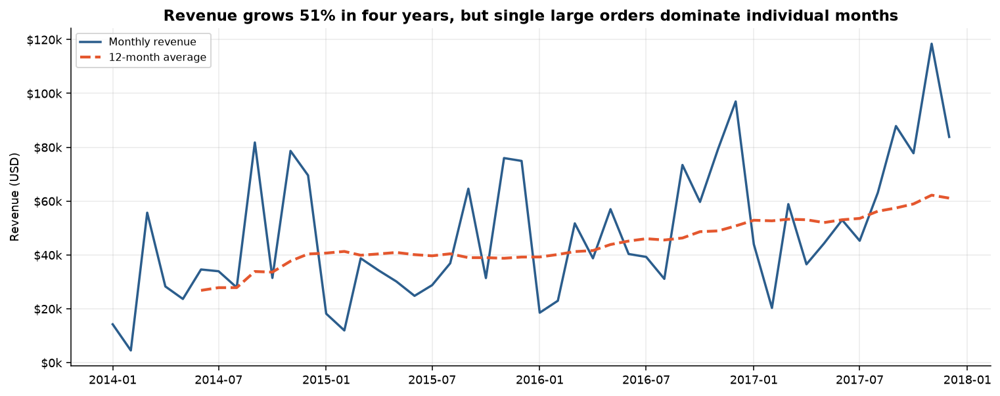
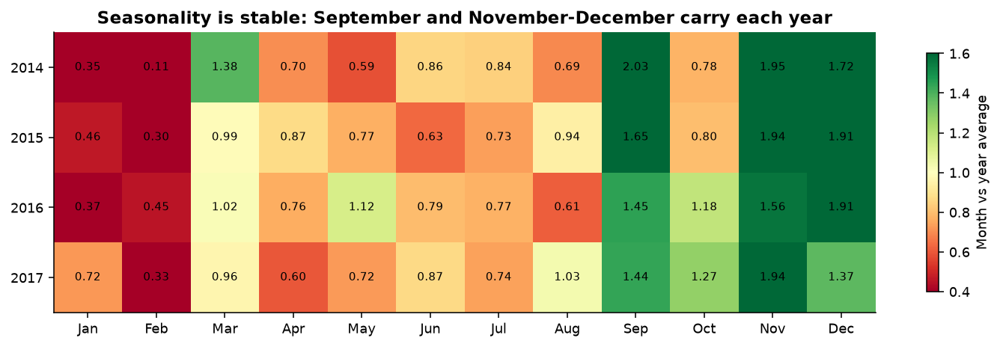
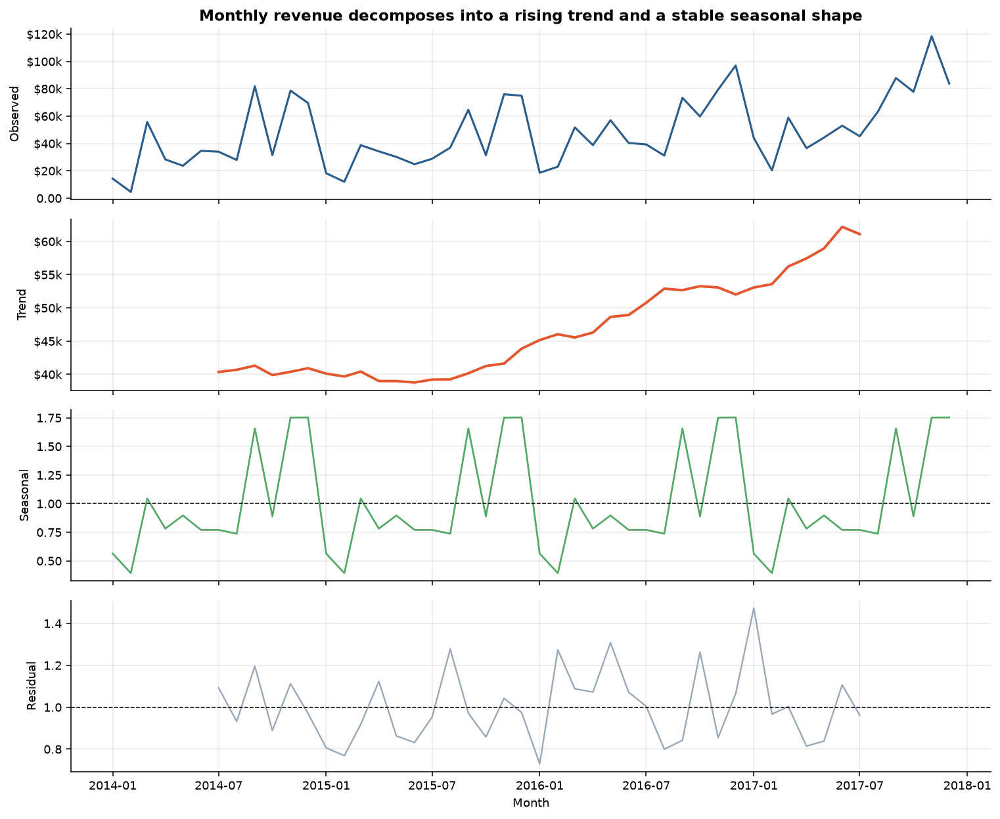
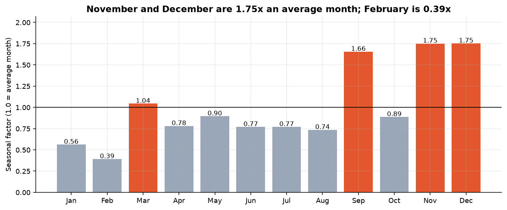
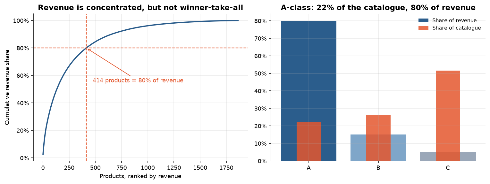
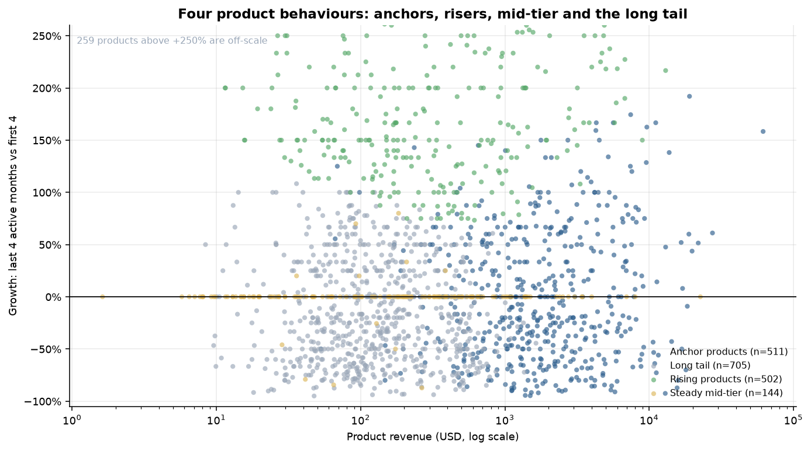
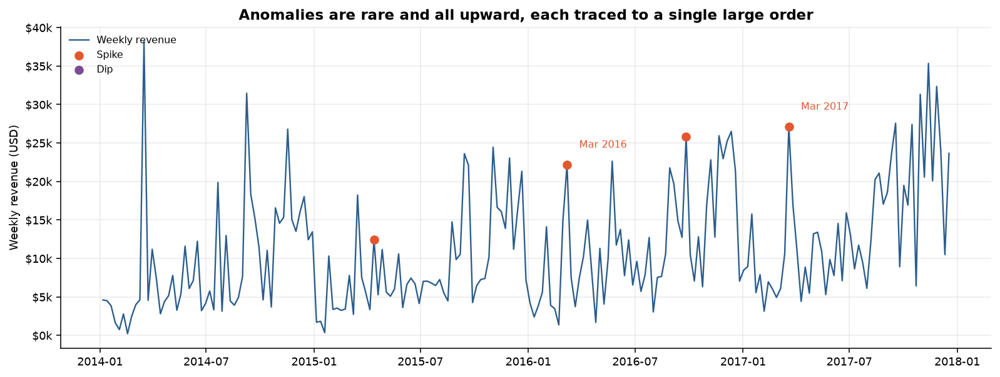
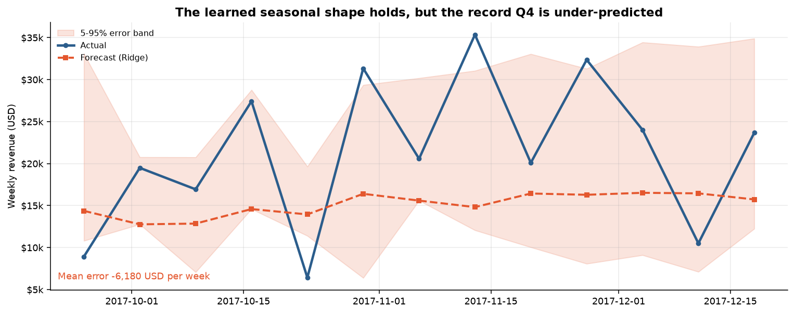

# Superstore product sales: a four-year time series

[](https://github.com/Manish27-tech/superstore-sales-timeseries/actions/workflows/ci.yml)
[](https://superstore-sales-timeseries.streamlit.app)

An end-to-end time-series project on the Tableau/Kaggle *Sample - Superstore*
extract: 9,994 order lines, 5,009 orders, 1,862 products, 2014-2017. It covers
verification, cleaning, aggregation, decomposition, product segmentation,
anomaly detection and a 13-week revenue forecast, with an interactive Streamlit
dashboard and a 72-test suite.

**Live dashboard:** https://superstore-sales-timeseries.streamlit.app
**Repository:** https://github.com/Manish27-tech/superstore-sales-timeseries

## Headline findings

- Revenue grew from **$484k in 2014 to $733k in 2017 (+51%)**, after a flat 2015.
- The series is strongly seasonal: **December is 1.75x an average month, February 0.39x**.
  Seasonality explains 86.7% of the detrended variance.
- **414 of 1,862 products (22.2%) generate 80% of revenue.** The A class is 22.2%
  of the catalogue and 80.0% of revenue.
- Margins leak at the discount tail: lines discounted more than 20% run at a
  negative margin.
- **4 of 97 comparable weeks are anomalies**, all upward, each traceable to a
  single large order (a $13,999.96 Canon copier, and similar).
- Forecasting 13 weeks ahead, Ridge beats the seasonal-naive baseline by
  **9.5% RMSE (MASE 0.95)** but under-predicts the record fourth quarter of 2017
  by $6,180 per week. The seasonal shape is learnable; the level shift is not.

## Figures

| | |
|---|---|
|  |  |
|  |  |
|  |  |
|  |  |

All 22 figures are in `reports/figures/`. The long-form write-up is
`reports/REPORT.md` and the model card is `reports/MODEL_CARD.md`.

## Quickstart

```bash
python -m pip install -r requirements.txt
python run.py all          # ~1 minute: download, analyse, forecast, export
python run.py dashboard   # opens the Streamlit app
python scripts/check_artifacts.py
python -m pytest -q       # 72 tests
```

## Project layout

```
src/superstore/        package: data, clean, features, eda, timeseries,
                       segments, anomalies, forecast, diagnostics, export,
                       report, pipeline
dashboard/             Streamlit app (app.py + views/)
scripts/               check_artifacts.py, build_notebook.py
tests/                 72 tests
docs/                  methodology, data dictionary, decisions, deployment
reports/               figures, summaries, REPORT.md, MODEL_CARD.md
data/dashboard/        committed feed the app reads
notebooks/             exploratory notebook
```

## Reproduce

The dataset is pinned by SHA-256 and by row, order, sales and profit totals;
the pipeline fails loudly if either changes. Raw and processed data are
git-ignored; the dashboard feed is committed, so the app runs without the raw
extract.

## Deploy

The app is deployed on Streamlit Community Cloud from `dashboard/app.py`. See
`docs/DEPLOYMENT.md` for the steps.

## Troubleshooting

- `FileNotFoundError: .../data/dashboard/kpis.json` — run `python run.py all`.
- `ValueError: ... sha256` — the pinned extract changed; check `config.DATASET_SHA256`.
- Streamlit shows a missing-module error — install `requirements.txt`, not just the
  dashboard extras.
- Tests fail with `FileNotFoundError: reports/metrics.json` — run the pipeline
  once before `pytest`.

