# Superstore product sales: a four-year time series

An end-to-end analysis of 9,994 order lines from the Tableau/Kaggle *Sample - Superstore* extract: what the revenue series is made of, which products carry it, which weeks break the pattern, and how well a 13-week-ahead forecast actually performs.

## Headline findings

- Revenue grew from $484,248 in 2014 to $733,215 in 2017 (**+50% across the two growth years**), after a flat 2015 (-2.8%).
- The series is strongly seasonal: **Dec** is 1.75x an average month and **Feb** is 0.39x. Seasonality explains 86.7% of the detrended variance, the trend 48.9% of the deseasonalised variance.
- Revenue is concentrated but not winner-take-all: **414 of 1,862 products (22.2%) produce 80% of sales**. The A class is 22.2% of the catalogue and 80.0% of revenue.
- Margins leak at the discount tail: lines discounted more than 20% run at a negative margin, and 11% of all lines are discounted by 40% or more.
- 4 of the 97 comparable weeks are anomalies (4.1%), all upward, and each is traceable to a single large order.
- Forecasting 13 weeks ahead, the selected model beats the seasonal-naive baseline by **11.2% RMSE** (MASE 0.95), but it under-predicts the record fourth quarter of 2017 by $6,180 per week. That is the honest headline: the seasonal shape is learnable, the level shift is not.

## The data

- 9,994 order lines, 5,009 orders, 793 customers, 1,862 products, 2014-01-03 to 2017-12-30.
- 209 weekly periods and 48 months. The two boundary weeks are incomplete and are dropped from every modelled series.
- Mean order value $459, median $152: a long tail of small orders and a handful of five-figure ones.
- 52.0% of lines carry a discount and 18.7% of lines are unprofitable (a return or a deep discount).

### Two data-quality notes that shape the analysis

1. **Weekday coverage is distorted.** Wednesday holds only 3.7% of order lines against 11-19% for every other day. That is a property of the published extract, not of the business, so weekday profiles are reported for completeness but are not used for any decision.
2. **Order ids occasionally disagree with the order date.** 7 lines dated 31 December 2016 carry 2017 order ids. The order date is treated as authoritative.

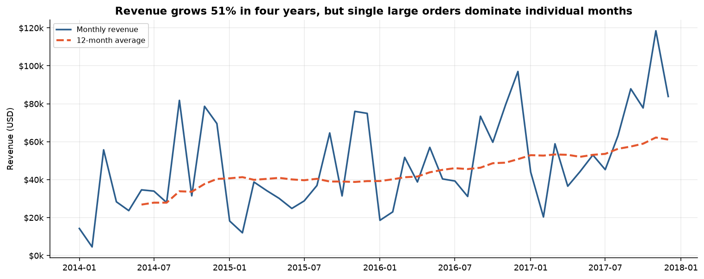

*Monthly revenue with a 12-month average*

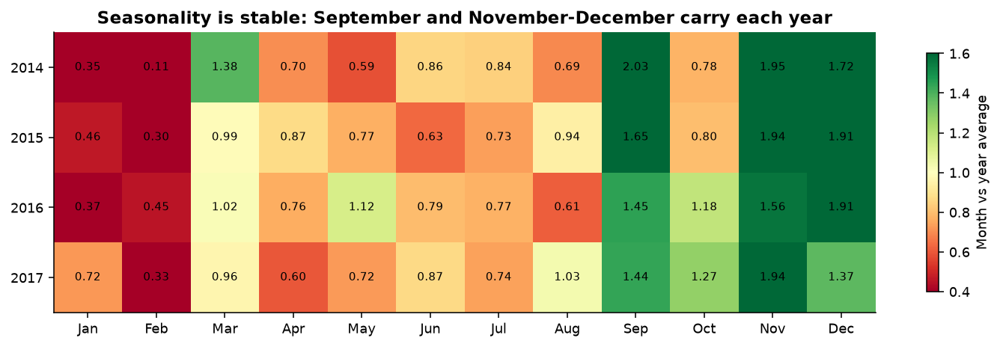

*Each month against its own year's average*


## Decomposition: trend versus season

A multiplicative decomposition puts the trend at $40,354 to $61,101 per month (51.4% over the 24 months with a centred average), with a peak-to-trough seasonal ratio of 4.5x. The residual is large -- 13.6% mean absolute deviation -- because single large orders move a month.

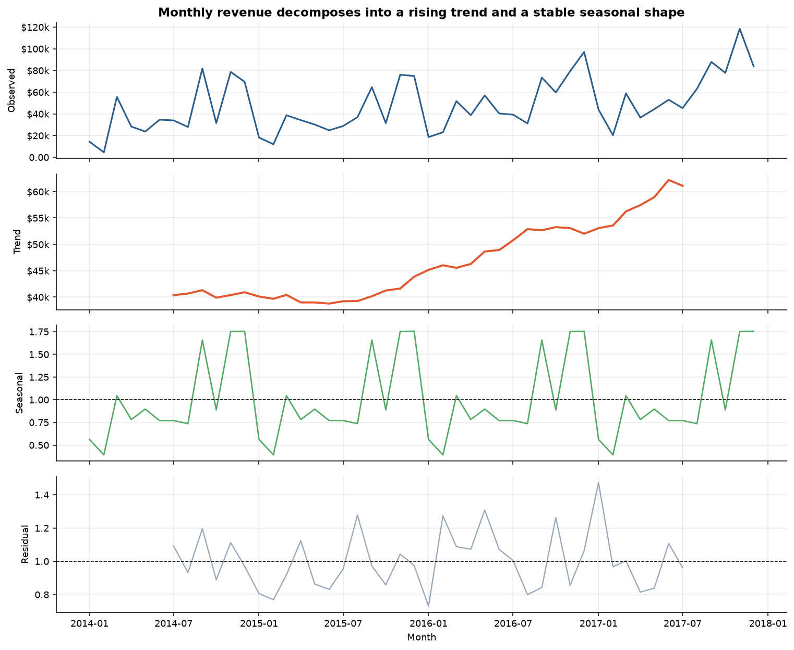

*Observed, trend, seasonal and residual components*

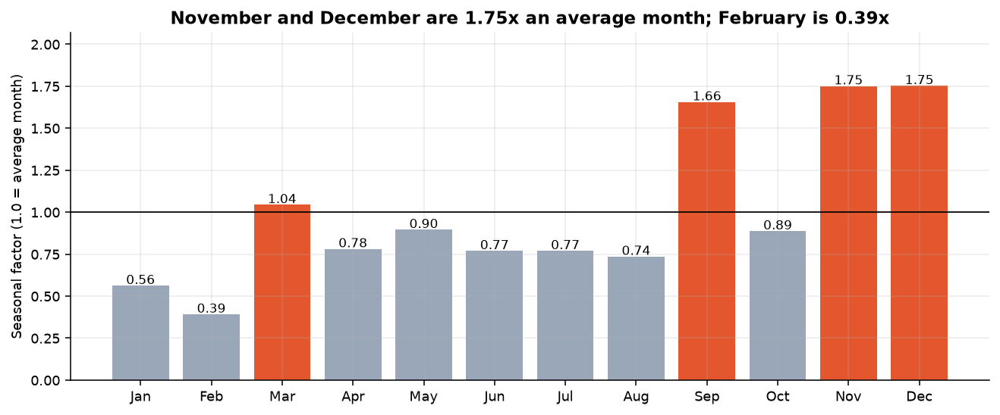

*Seasonal factors by calendar month*


## Products: concentration, behaviour and margin

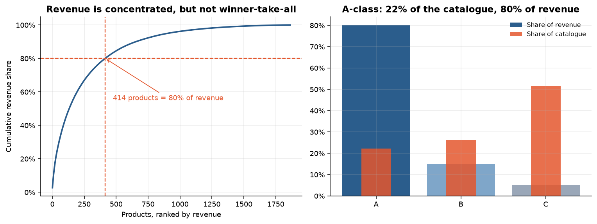

The catalogue splits into four behavioural groups from a k-means fit on scale, growth, volatility and margin. Anchors are 68.5% of revenue across 511 products; the long tail is 705 products contributing 5.9%.

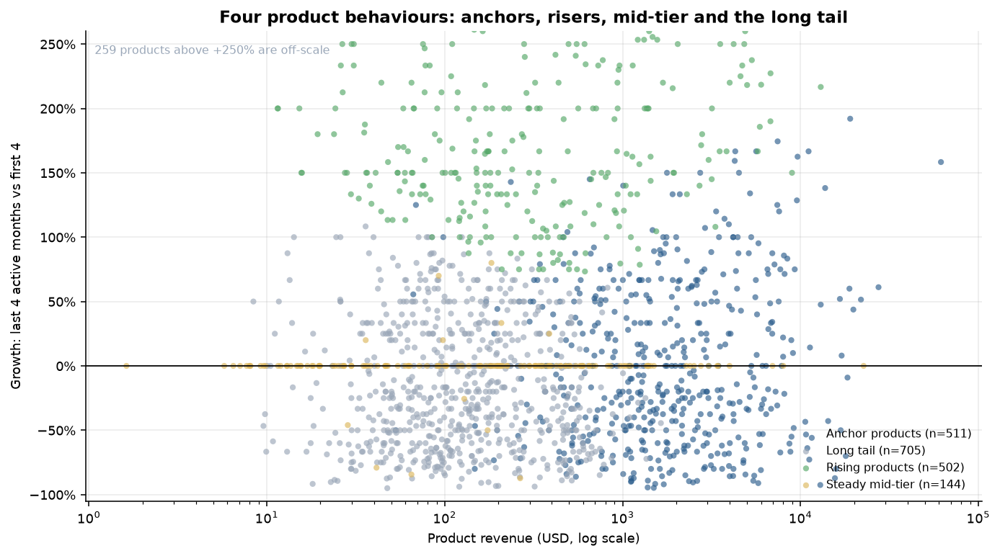

*Products by revenue and growth, coloured by segment*

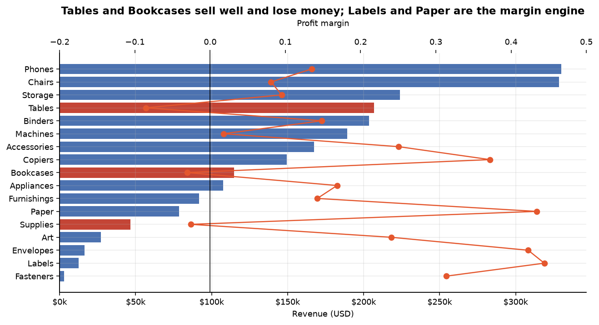

*Sub-category revenue against profit margin*

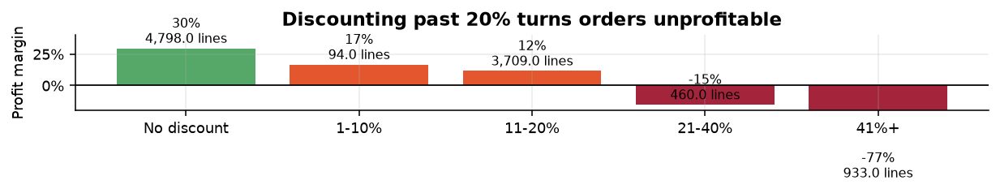

*Margin by discount band*


The margin story is blunt: Tables is the worst sub-category by margin and Labels the best. Discounting is the mechanism -- the 21-40% band already loses money before overheads.

## Weeks that break the pattern

Anomalies are scored against the same week a year earlier with a robust z-score, and are only flagged when the baseline exceeds $2,000 and the absolute gap exceeds $3,000.

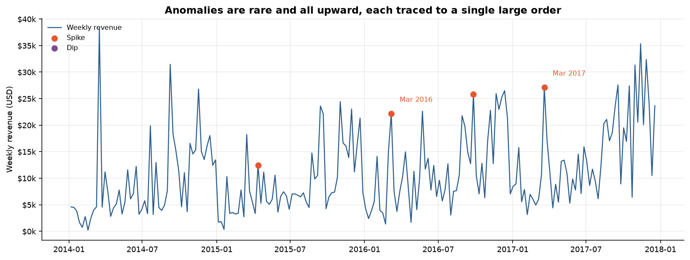

*Weekly revenue with flagged anomalies*

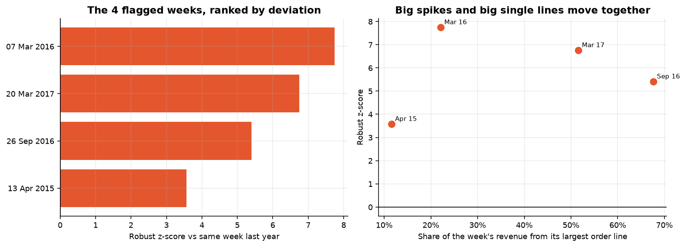

*The flagged weeks and their largest single order line*


| Week | Direction | z | Revenue | Expected | Largest line |
|---|---|---|---|---|---|
| 2016-03-07 | spike | 7.74 | $22,185 | $2,729 | $4,913 |
| 2017-03-20 | spike | 6.75 | $27,125 | $3,740 | $14,000 |
| 2016-09-26 | spike | 5.40 | $25,858 | $4,267 | $17,500 |
| 2015-04-13 | spike | 3.57 | $12,472 | $2,810 | $1,448 |

## Forecasting 13 weeks ahead

The forecast is a **fixed-origin, direct multi-step** problem: standing at the last training week (week of 2017-09-18), predict the next 13 weeks. A lag-1 setup would leak the answer, so the data is reshaped into one row per (origin, horizon) pair with features known at the origin: the 13-week rolling level, the same week 52 weeks earlier, the target week's calendar position, and the horizon itself.

- **Selection** uses the mean walk-forward RMSE inside the training period: Ridge $8,040, gradient boosting $8,581. Ridge wins and is the reported model.
- **Hold-out (13 weeks, 2017-09-18 onward):** RMSE $10,409, MAE $9,089, MAPE 46.4%, MASE 0.95.
- The seasonal-naive baseline scores RMSE $11,719 and MAPE 53.5%, so the model cuts error by 11.2%.
- **R² is -0.43.** That is not a typo: over thirteen weeks that set a new record for the business, predicting the window mean would have scored better. The model is still the better forecaster in MASE terms because it tracks the seasonal shape week by week.
- Gradient boosting, which was *not* selected, actually scored better on this window ($9,718 RMSE). With four backtest folds, selection noise is larger than the gap between the two models; that is stated rather than hidden.
- The 5-95% error band covered 61.5% of held-out weeks against a nominal 90%, another symptom of the level shift.

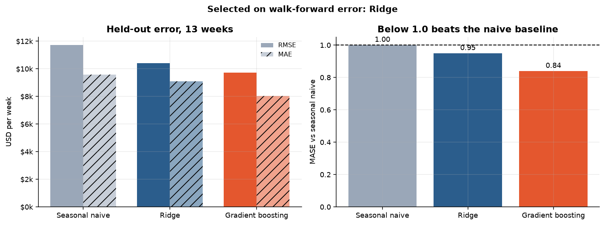

*Held-out error and MASE by model*

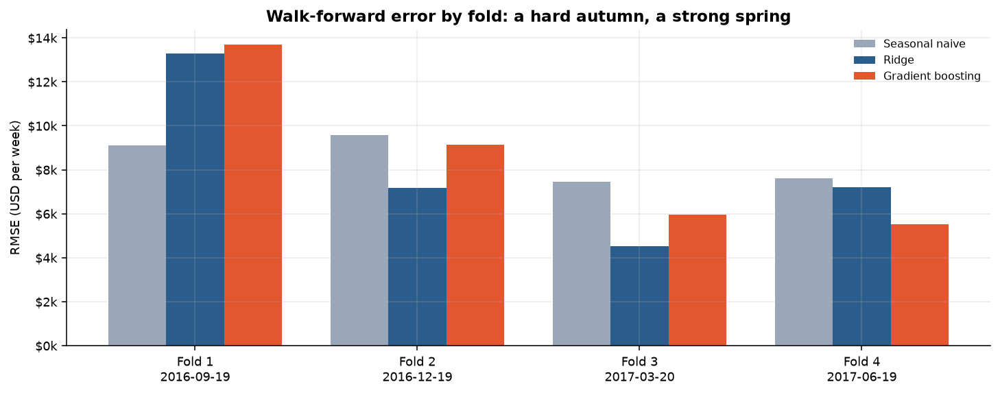

*Walk-forward RMSE by fold*

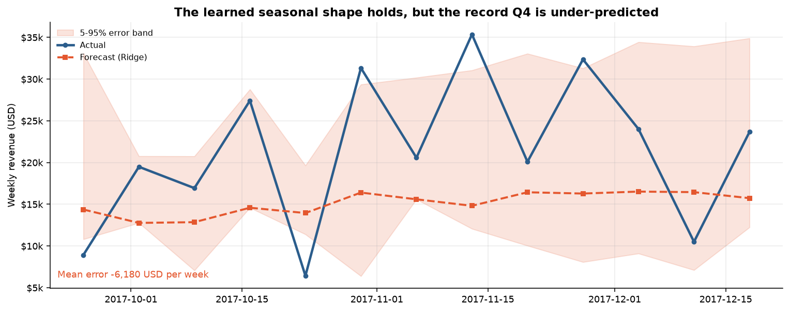

*Forecast against actuals for the held-out quarter*

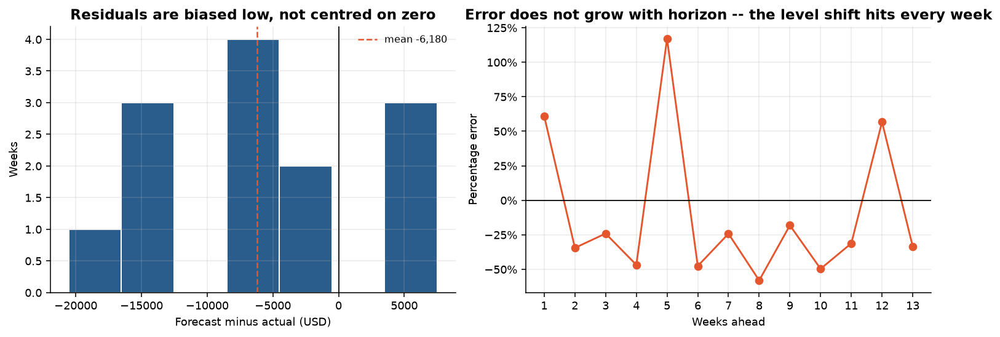

*Residual distribution and error by horizon*


### Why the fourth quarter is hard

The training period contains three fourth quarters, none as large as 2017's. Every model class tested here -- Ridge, gradient boosting, and a ratio-to-last-year formulation tried during development -- under-predicted it. The practical fix is not a better regressor on 194 weekly rows; it is a shorter forecast horizon, a leading indicator, or an explicit level-shift adjustment owned by a planner.

## What I would do next

- Forecast at four-week blocks, where single orders average out and the seasonal signal dominates.
- Model order counts and average order value separately, then multiply; the lumpiness lives in the value term and is easier to attribute.
- Add promotion and catalogue metadata. The extract has no marketing calendar, which is the missing variable behind most of the residual.

## Reproduce

```bash
python -m pip install -r requirements-dev.txt
python run.py all          # ~1 minute: download, analyse, forecast, export
python run.py dashboard    # opens the Streamlit app on the committed feeds
```

The dataset is pinned by SHA-256 and by business totals; the pipeline fails loudly if either changes. Raw and processed data are git-ignored, the dashboard feed is committed.
